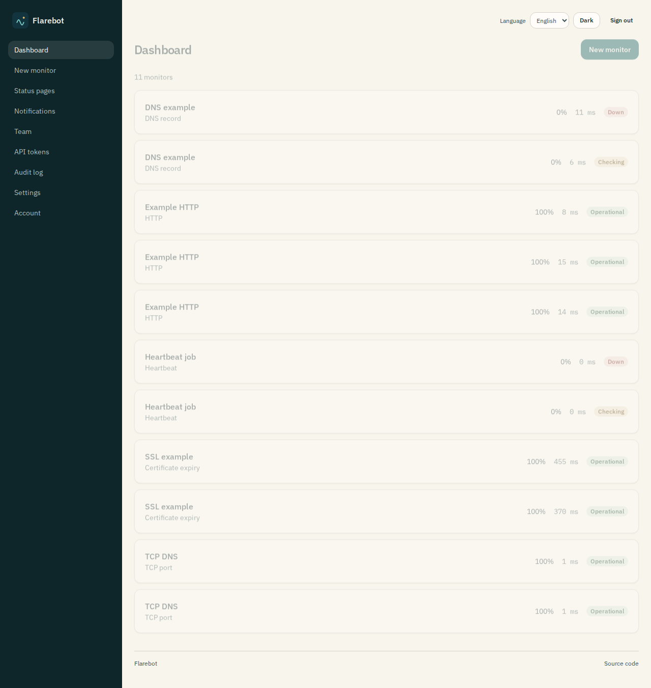
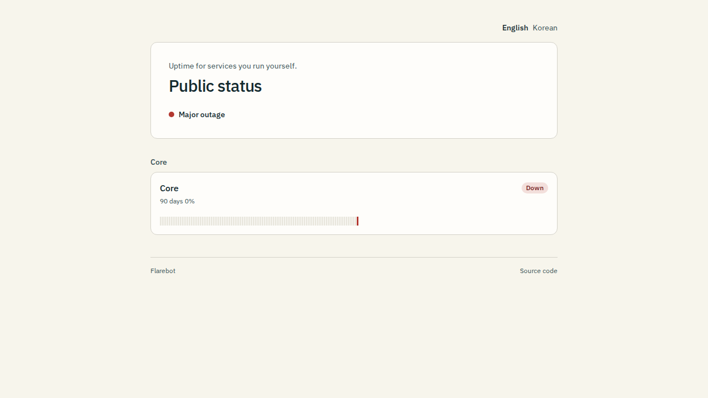

# Flarebot

Self-hosted uptime monitoring and status pages on Cloudflare Workers.

[](LICENSE)
[](https://workers.cloudflare.com/)

<p align="center">
  
</p>

Flarebot checks HTTP, TCP, DNS, certificate expiry, and heartbeat endpoints, confirms an outage before it notifies you, and publishes a status page. It runs entirely on the Workers free plan: a Hono API, Durable Objects for the schedule and the mail outbox, D1 for configuration and uptime rollups, and Analytics Engine for raw samples.

## Features

- Setup wizard that creates the Owner
- HTTP, TCP, DNS, SSL expiry (CT-log estimate), and heartbeat monitors
- Pending, then down, so a single blip does not page anyone
- Email (SMTP or Cloudflare Email Service), Discord, Slack, Telegram, and webhooks
- Status pages with per-field translations and a language switcher
- Uptime and response charts from local rollups
- Owner, Admin, Editor, and Viewer roles, passkeys, passwords, optional TOTP, and scoped API tokens
- Admin UI in English and Korean
- Rebrand by editing `brand/` and asking your own coding agent

<p align="center">
  
</p>

## Deploy

[](https://deploy.workers.cloudflare.com/?url=https://github.com/p-sw/flarebot)

The button provisions D1 from the placeholder database id in `wrangler.jsonc`. It does not set secrets. After it finishes:

```bash
npx wrangler secret put SETUP_SECRET
npx wrangler secret put ENCRYPTION_KEY
```

`ENCRYPTION_KEY` is 32 bytes of base64 (`openssl rand -base64 32`). Open `/setup`, enter the setup secret, and create the Owner. After that, sign in at `/login`. The admin UI is `/console`. Mail can wait. See [docs/deployment.md](docs/deployment.md) for the manual path and for SMTP secrets.

Nothing in this repository is deployed for you. The Wrangler config has no account id.

## Run locally

Node 22 and pnpm 10.

```bash
pnpm install
cp .dev.vars.example .dev.vars
pnpm exec playwright install chromium   # only for end-to-end tests
pnpm dev
```

Open http://127.0.0.1:5173/setup. The sample setup secret is `change-me-setup-secret`. Replace it before you expose the dev server. Sign in at `/login`. The admin UI is `/console`.

## URLs

| URL         | Purpose                                                               |
| ----------- | --------------------------------------------------------------------- |
| `/`         | Public status page chosen as the site root, or a redirect to `/login` |
| `/s/<slug>` | Public status page. Still works for the page served at `/`            |
| `/login`    | Sign in. A signed-in visit redirects to `/console`                    |
| `/console`  | Admin dashboard and the rest of the admin UI                          |
| `/setup`    | Create the first owner. Redirects to `/login` once setup is done      |

Bookmarks under the old admin paths (`/monitors/...`, `/status-pages`, `/settings`, and the other console sections) redirect to `/console/...`. A status page setting, "Serve at the site root", chooses which published page answers `/`. Only one page can hold that setting. Turning it on for one page turns it off for the other.

## Configuration

| Name                                                     | Purpose                                                 |
| -------------------------------------------------------- | ------------------------------------------------------- |
| `SETUP_SECRET`                                           | Required. Setup stays closed until this is set.         |
| `ENCRYPTION_KEY`                                         | Required. Encrypts tokens, TOTP, and the SMTP password. |
| `SMTP_HOST`, `MAIL_FROM`, and the other `SMTP_*` secrets | Optional. Override the mail settings stored in D1.      |
| `TURNSTILE_SECRET_KEY`                                   | Optional. When set, login and setup require Turnstile.  |

Details: [docs/configuration.md](docs/configuration.md). Email behavior: [docs/email.md](docs/email.md).

## Branding

The files a deployer is meant to change live in [`brand/`](brand/). Colors, type, motion, copy, logos, and a few slot components are there so a later `git pull` of Flarebot does not fight your theme.

Ask your agent to follow [AGENTS.md](AGENTS.md). The skills in [`.agents/skills/`](.agents/skills/) cover a rebrand, ejecting a component, upgrading, adding a language, a notification channel, a monitor type, or a mail driver. `pnpm brand:check` fails if a rebrand spills outside `brand/`.

## Updating

```bash
git pull
pnpm install
pnpm exec wrangler d1 migrations apply DB --remote
pnpm deploy
```

If you have local branding, use the `upgrade-flarebot` skill and read [brand/MIGRATION.md](brand/MIGRATION.md) before you merge.

## Development

[docs/development.md](docs/development.md) and [CONTRIBUTING.md](CONTRIBUTING.md). Hooks format staged files, typecheck, and require Conventional Commits. GitHub Actions runs the same checks plus Playwright.

## License

[MIT](LICENSE). Copyright (c) 2026 Shinwoo PARK.

The footer shows a source link when `brand/brand.config.ts` sets `links.source`. The stock config points at this repository. Clear that field to hide the link. It is a default, not a license requirement.
