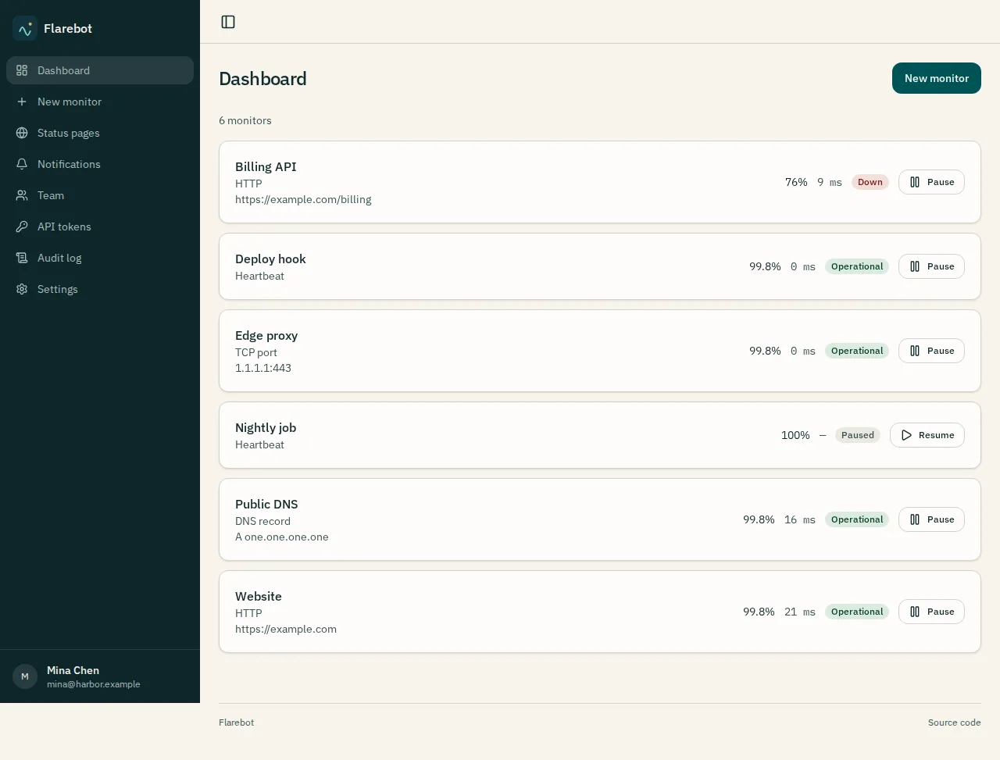
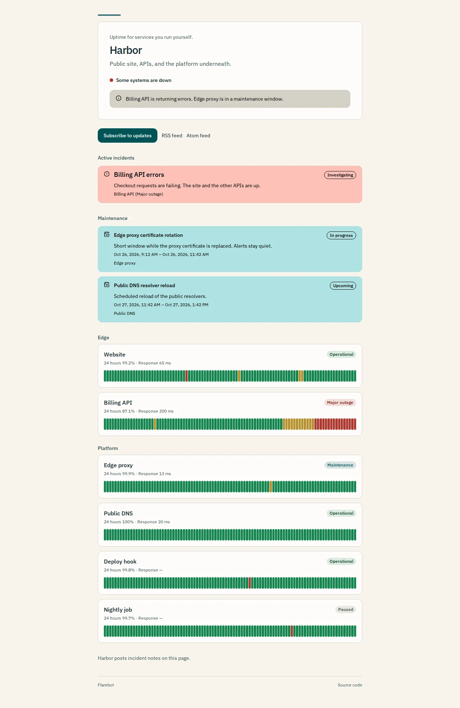

# Flarebot

Self-hosted uptime monitoring and status pages on Cloudflare Workers.

[](LICENSE)
[](https://workers.cloudflare.com/)

Flarebot checks HTTP, TCP, DNS, certificate expiry, and heartbeat endpoints, confirms an outage before it notifies you, and publishes a status page. It runs on the Workers Free plan: a Hono API, Durable Objects for the schedule and the mail outbox, D1 for configuration and uptime rollups, and Analytics Engine for raw samples. A modest deployment fits on Free. The [Workers Paid plan](#workers-paid-plan) (minimum $5 per month) is recommended when a daily quota or a per-invocation cap gets tight.

## Preview

<table>
  <tr>
    <td width="410" align="center" valign="top">
      
      <br />
      Console dashboard
    </td>
    <td width="410" align="center" valign="top">
      
      <br />
      Public status page
    </td>
  </tr>
</table>

The dashboard lists every monitor. Expand a row to see recent response time. The images in this file are from a local demo database. Regenerate them with `pnpm screenshots`. That command does not read production data.

## Table of contents

- [Preview](#preview)
- [Table of contents](#table-of-contents)
- [Features](#features)
- [Deploy](#deploy)
- [Workers Paid plan](#workers-paid-plan)
- [Run locally](#run-locally)
- [Configuration](#configuration)
- [Branding your deployment](#branding-your-deployment)
- [Updating](#updating)
- [Development](#development)
- [License](#license)

## Features

- HTTP, TCP, DNS, SSL expiry (CT-log estimate), and heartbeat monitors
- Email (SMTP or Cloudflare Email Service), Discord, Slack, Telegram, webhooks, ntfy, Gotify, Pushover, Microsoft Teams, Google Chat, and Matrix
- Public status pages, works in site root
- Manual incidents with a public timeline, and maintenance windows that hold alerts and stay out of the uptime percentage
- Visitor subscriptions on a status page: confirmed email, signed webhooks, and cached RSS and Atom feeds
- Uptime charts and response time (TTFB for HTTP) from local rollups
- Public SVG badges for status, uptime, and response time (TTFB for HTTP). A private monitor returns an unknown badge
- Owner, Admin, Editor, and Viewer roles, passkeys, passwords, optional TOTP, scoped API tokens, and optional OpenID Connect or Cloudflare Access sign-in
- One English copy file, `brand/locale.json`. A fork edits that file to translate the whole product
- Rebrand by editing `brand/` and asking your own coding agent

## Deploy

[](https://deploy.workers.cloudflare.com/?url=https://github.com/p-sw/flarebot)

The button provisions D1 from the placeholder database id in `wrangler.jsonc`. It does not set secrets. After it finishes:

```bash
npx wrangler secret put SETUP_SECRET
npx wrangler secret put ENCRYPTION_KEY
```

`ENCRYPTION_KEY` is 32 bytes of base64 (`openssl rand -base64 32`). Open `/setup`, enter the setup secret, and create the Owner. After that, sign in at `/login`. The admin UI is `/console`. Owners and Admins can add OpenID Connect and Cloudflare Access in Settings. The Authentik steps, and the steps for Authentik behind Cloudflare Access, are in [docs/sso.md](docs/sso.md). Mail can wait. See [docs/deployment.md](docs/deployment.md) for the manual path and for SMTP secrets.

Nothing in this repository is deployed for you. The Wrangler config has no account id.

## Check region

Settings → Check region chooses where the scheduler runs. **Automatic** is the default and does not send a location hint, which is the behavior of an existing installation: the first shard is `shard-0`, created near the cron that first touched it. Pick a region close to the hosts you monitor and to the people who open the status page. `apac` is Asia-Pacific. `apac-ne` is the northeast of that region (Korea, Japan, and nearby). `apac-se` is the southeast. A Durable Object does not move after it is created, so a new choice creates a new shard and moves checks onto it. Status, confirmations, open incidents, and uptime history stay. The in-memory recent response chart starts over. A monitor can override the global choice, or stay on Automatic while the rest of the installation moves. See [docs/development.md](docs/development.md).

## Workers Paid plan

Flarebot is built so a deployment can stay on the [Workers Free plan](https://developers.cloudflare.com/workers/platform/pricing/). Checks, mail, and the public status page all run there. The [Workers Paid plan](https://developers.cloudflare.com/workers/platform/pricing/) is a recommendation, at a minimum of $5 USD per month for the account. Paid removes the hard daily cutoffs and raises the per-invocation caps below. Usage past the included monthly amounts is billed. It does not change the scheduler code: the minimum check interval stays 60 seconds, and one alarm still runs at most 12 checks.

Figures below are from Cloudflare's docs as of October 2026. Links are at the end of this section. Estimates are labeled, and each one shows the formula. They count this Worker only. Other Workers on the same account share the account quotas.

### Limits that matter

| Limit                             | Workers Free                                                           | Workers Paid                                                          |
| --------------------------------- | ---------------------------------------------------------------------- | --------------------------------------------------------------------- |
| Worker requests                   | 100,000 / day, then error 1027                                         | No daily cap. 10 million / month included, then $0.30 / million       |
| CPU, HTTP request                 | 10 ms                                                                  | 5 min maximum (default 30 s)                                          |
| CPU, cron trigger                 | 10 ms                                                                  | 30 s when the cron interval is under 1 hour. 15 min at 1 hour or more |
| CPU, Durable Object (alarm, RPC)  | Same per-invocation limit as Workers (10 ms on Free)                   | 30 s default, configurable up to 5 min                                |
| Subrequests                       | 50 external / invocation, plus 1,000 to Cloudflare services such as D1 | 10,000 / invocation by default, configurable up to 10 million         |
| Simultaneous outgoing connections | 6                                                                      | 6                                                                     |
| D1 queries per invocation         | 50                                                                     | 1,000                                                                 |
| D1 rows read                      | 5 million / day                                                        | 25 billion / month included, then $0.001 / million rows               |
| D1 rows written                   | 100,000 / day                                                          | 50 million / month included, then $1.00 / million rows                |
| Durable Object requests           | 100,000 / day                                                          | 1 million / month included, then $0.15 / million                      |
| Durable Object duration           | 13,000 GB-s / day                                                      | 400,000 GB-s / month included, then $12.50 / million GB-s             |

Free daily quotas reset at 00:00 UTC. After that reset, a query or a Durable Object call that exceeded its Free cap fails until the next midnight. Paid has no such daily stop; the included amounts are monthly, and further use is charged. Static assets (the console JavaScript and CSS) are free and unlimited on both plans, so they do not spend the request quota. Cloudflare does not bill subrequests as Worker requests.

A few published differences do not bind Flarebot. The account cron-trigger cap is 5 on Free and 250 on Paid, and this Worker uses one (`*/5 * * * *`). Alarm and cron wall time is 15 minutes on both plans. Flarebot does not use [Queues](https://developers.cloudflare.com/queues/); mail and announcements are D1 outbox rows drained by that cron. Check history is rollups in D1, not one row per sample, so the 500 MB Free database size (10 GB on Paid) is not the usual ceiling.

### How the code spends those limits

**Schedule.** Durable Object alarms run the checks. The cron only repairs a missing alarm, rolls daily totals, prunes history, and drains mail, announcements, and visitor subscriptions. Each alarm runs at most 12 due checks (`CHECKS_PER_ALARM`), with at most 6 in flight (`CHECK_CONCURRENCY`), because both plans allow 6 connections that are still waiting for response headers. Shard capacity is `floor(6 * interval / timeout)` monitors. The defaults, 60 seconds and a 10 second timeout, fit 36 monitors on a shard. Further due checks wait for a follow-up alarm 500 ms later. The cron fires 288 times a day (`24 * 60 / 5`). That invocation stops at 40 D1 statements (`FREE_CRON_STATEMENT_BUDGET`). Prune, maintenance signals, and the outbox drains leave unfinished rows for the next run.

**CPU.** Time waiting on HTTP, TCP, DNS, or D1 does not count. The 10 ms Free budget is the JavaScript on that invocation: applying check results, parsing a flushed hour's `samples_json` (the merge keeps the last 120 samples), pruning, and decrypting a channel config. The daily rollup recompute is the SQL statement `INSERT INTO uptime_daily ... SELECT ... GROUP BY`. Retention length stays in that query, outside the 10 ms of JavaScript. This section has no measured timing; 10 ms is the budget that work has to fit in. On Paid, this Worker's five-minute cron gets 30 seconds of CPU. Durable Object alarms follow the same per-invocation CPU rule as the Worker. Paid's default ceiling there is 30 seconds, and `limits.cpu_ms` can raise it to 5 minutes. Flarebot does not set `limits.cpu_ms`.

**Subrequests.** An HTTP, DNS, or certificate check is one `fetch`. Each redirect hop counts as another subrequest. A certificate check can fall back to a second `fetch`. TCP uses `connect()`, which counts against the 6 connections and is not a Fetch subrequest. A confirmed down, recovery, or flapping alert fetches each non-email channel inside that same alarm. A monitor may attach 20 channels. Email is one `mail_outbox` insert; the mailer Durable Object sends one message per alarm and rearms. The five-minute cron sends at most 8 announcement rows and at most 6 visitor deliveries. Twelve checks plus one 20-channel alert is 32 external fetches, inside Free's 50, until several monitors alert on the same alarm or redirects add hops. Paid's default of 10,000 is the headroom for that burst. The code still stops at 12 checks per alarm and does not retry a failed channel fetch.

**D1 writes and reads.** A check does not write a D1 row. The shard keeps samples in memory. It upserts a 15-minute `uptime_slots` row when the bucket closes, about 96 times per monitor per day (`24 * 60 / 15`). While a shard alarms at least every five minutes (true at the default 60-second interval), it also flushes the open hour about 288 times a day (`24 * 60 / 5`): one hourly upsert and one `monitor_state` upsert per monitor that had samples. Estimate, table rows only, per monitor per day, before alerts and before index rows: `96 + 288 + 288 = 672`. Cloudflare counts an extra row written when a write touches an indexed column. `uptime_slots` has a secondary index on `slot_start`, so the metered write count can be higher than 672.

The five-minute flush is 3 D1 statements for any number of monitors `M` on the shard: one maintenance read, one `batch()` of the hourly reads, and one `batch()` of the upserts (the hourly row, a dirty mark when that UTC day is not already marked, and `monitor_state`). [`db.batch()` counts as one query](https://developers.cloudflare.com/d1/platform/limits/) against the per-invocation cap. A shard of 36 is 3 statements. Rows read and rows written are still metered per row. The dirty mark is one insert per monitor per UTC day: the shard remembers the marked day and skips the insert when it matches. A slot close and an hour change are separate per-monitor statements on the alarm that crosses the bucket. They are not part of that flush count.

After the one-time backfill, the daily rollup is incremental and set-based. Let `N` be monitors, `R` retained days (the default is 90), `C` = 288 cron runs per day, `H` ≤ 24 hourly rows per monitor on a closed day, and `k` the number of closed days rewritten that day (1 after UTC midnight, sometimes 2 when a later flush marks yesterday again). The open UTC day is not written to `uptime_daily`.

- Statements in that cron, for the rollup alone: 2 when nothing closed is dirty (read `rollup_watermark`, then scan `rollup_dirty` for days before today). 4 when one or two closed days are dirty (those two, plus one `INSERT INTO uptime_daily ... SELECT ... GROUP BY` and one `DELETE`). Both days share that insert and that delete, so a second dirty day adds no statement. The count does not depend on `N` or `R`.
- Rows read per day, estimate: `C * (1 + N) + k * N * H`. The first term is the watermark row and the dirty-table scan on every cron. The second term is the hourly rows read while rewriting closed days.
- Rows written per day, estimate: `N + k * N` logical rows (one dirty insert per monitor, plus `k` daily upserts per monitor). Metered writes are about twice that. D1 counts an index row when a write includes an indexed column, and `rollup_dirty` has secondary index `rollup_dirty_day_idx`.

Estimate, `N = 36`, `H = 24`, `k = 2`: reads are `288 * (1 + 36) + 2 * 36 * 24 = 12,384`. Logical writes are `36 + 2 * 36 = 108`, about 216 metered. Both sit under 5 million reads and 100,000 writes. The flush's table rows are the larger D1 term: `36 * 672 = 24,192` before the `uptime_slots` index rows. The same formulas are in [docs/development.md](docs/development.md).

A one-time backfill walks history that already exists, one closed day per cron, newest first, and then stops. `rollup_watermark.pending_before` is `0` before the walk, a positive upper bound during it, and `-1` when it is finished. The first cron is 7 statements, because it also marks today. Later steps are 6. It runs at most `R` crons. Each step reads one hour to find the day, then about `N * H` hourly rows, and writes `N` daily rows. For 36 monitors and 90 days that is about `90 * 36 * 24 = 77,760` hourly rows read and `90 * 36 = 3,240` daily rows written, spread across those crons (90 steps is 7.5 hours). Migration `0009_rollup_incremental.sql` does not rewrite `uptime_hourly` or `uptime_daily`.

The whole cron stops at 40 statements. That cap is under Free's 50 queries per invocation. A 90-day history stays inside it: one monitor is 2 or 4 rollup statements, the same as 36, and a flush of 36 monitors is 3. Prune, maintenance signals, and the announcement, subscription, and mail drains check the remaining budget and leave unfinished rows for the next run.

Pruning deletes at most 80 rows per table per run and at most 20,000 rows per UTC day. Deletes count as rows written. Steady state is much smaller than the cap: about one day of slots, hours, and a daily row per monitor (`96 + 24 + 1`). The cap is there so a retention cut does not consume the whole 100,000 writes.

**Durable Objects.** An alarm invocation and each RPC (`ensureAlarm`, `getAll`, `getOne`, the mailer `kick`) count as a Durable Object request. Duration is wall-clock time while the object is active, billed as if it holds 128 MB: GB-s = `seconds * 128 / 1000`. Waiting on a check counts. Hibernating between alarms does not.

Check regions do not multiply that cost. The cron calls `ensureAlarm` once per shard that has monitors in D1, not once per location hint. An unused region has no shard and no alarm. Changing the global region or a monitor override moves monitors in batches of 4, and each move is one detach, one upsert, and one `ensureAlarm` on the destination. That is a few Durable Object requests per moved monitor, paid once. After the move, the alarm rate is the formula below: it follows how many checks run, not how many regions are listed in Settings. A shard with no monitors deletes its alarm, so the old region stops spending duration. The placement pass itself is at most 14 D1 statements (`2 + 4 * 3`), inside the cron cap of 40.

If monitors are spread out, each check is its own alarm. Estimate: `N * (86400 / intervalSeconds)` alarm requests per day. At 60 seconds that is `N * 1440`, plus `288` `ensureAlarm` calls per shard and `288` mailer kicks. Thirty-six monitors are `36 * 1440 = 51,840` alarms, under the Free 100,000. One hundred staggered monitors are `100 * 1440 = 144,000` alarms, over it. If checks share an alarm (up to 12), the request count drops toward `ceil(N / 12) * 1440`.

Duration estimate: `alarmsPerDay * averageCheckSeconds * 0.128` GB-s. Free allows 13,000 GB-s per day, which is `13000 / 0.128 = 101,562.5` active seconds. Thirty-six staggered monitors at 0.3 seconds each are `51840 * 0.3 * 0.128 = 1,990.656` GB-s. The same fleet at 2 seconds is `51840 * 2 * 0.128 = 13,271.04` GB-s, over the Free day. Paid includes 400,000 GB-s per month, close to using the Free daily cap every day (`13000 * 30 = 390,000`), and then bills $12.50 per million GB-s. The included Durable Object requests are 1 million per month, which is less than maxing Free's 100,000 on all 30 days (`100000 * 30 = 3,000,000`). Paid still helps there: a single day may pass 100,000 without the scheduler stopping until midnight, and further requests are $0.15 per million.

**Status pages and badges.** `GET /` and `GET /s/:slug` are `Cache-Control: private, no-store` and call `loadPublicStatus`. The page at `/s/:slug` then fetches `/api/public/status/:slug` once. Estimate: 2 Worker requests per visit there. The site root does that load in the document, then the route loader fetches `/api/public/root`, then the page query fetches `/api/public/root` again under a different query key. Estimate: 3 Worker requests per visit to `/`. Each of those loads also calls `getAll` once per shard. If the cron's 288 requests are the only other Worker traffic, `(100000 - 288) / 2 = 49,856` slug visits, or `(100000 - 288) / 3 = 33,237` root visits, fit in a day. Estimate, assuming no badges and no console traffic. Badges and the console come out of the same 100,000.

A public badge is one Worker request per image that reaches Cloudflare. The response is `public, max-age=120` and is stored in the Cache API, so a repeat inside the Worker does not read D1 or wake a shard. Workers run before Cloudflare's cache, and a Cache API hit is still a Worker request, so a busy README can spend the daily request cap even while D1 stays cheap. Three images (status, uptime, response) are three requests per uncached view. On Paid there is no daily request cutoff. The included 10 million requests per month are `10000000 / 30 ≈ 333,000` per day; further requests are $0.30 per million.

### What is better on Paid

For this codebase, Paid is headroom, not a different product:

- The public status page and badges keep being served after 100,000 Worker requests in a UTC day.
- The five-minute cron and the scheduler alarms get 30 seconds of CPU instead of 10 ms for the JavaScript on that invocation: check results, parsing `samples_json` on a flush, pruning, and decrypting a channel config.
- An alarm can absorb a burst of channel fetches past Free's 50 external subrequests. Twelve checks plus one 20-channel alert is 32. Two such alerts on the same alarm are `12 + 40 = 52`. The cron's own external fetches stay small (at most 8 announcement rows and 6 visitor deliveries).
- The rollup (2 or 4 statements), the flush (3 statements for any shard), and the cron cap (40) all sit inside Free's 50 queries per invocation, so Paid's 1,000-query cap is spare headroom for this code. Paid still removes the daily hard stop on 5 million reads and 100,000 writes, and includes 25 billion reads and 50 million writes per month. The writes that grow with `N` are the flush upserts, about 672 table rows per monitor per day, plus about `N + k * N` rollup rows.
- Durable Object alarms keep firing after 100,000 requests or 13,000 GB-s in one day. Past the monthly included amounts you pay for the overage instead of waiting for 00:00 UTC.

Paid does not raise the 6-connection cap, does not raise `CHECKS_PER_ALARM`, and does not allow intervals under 60 seconds. A short check interval is an application limit, not a plan limit.

### When Free is enough

Free holds a deployment whose public pages and badges stay inside 100,000 Worker requests a day, whose alarms stay inside 100,000 Durable Object requests and 13,000 GB-s a day, whose JavaScript fits in 10 ms, and whose checks plus channel fetches stay inside 50 external subrequests on one invocation. The cron caps itself at 40 D1 statements. Retention length drops out of that count: one monitor kept for 90 days is 2 or 4 rollup statements, and a flush of 36 monitors is 3.

Estimate that fits: 5 monitors, the default 90-day retention, a 60-second interval, checks around 0.3 seconds, staggered alarms, a private status page, and alerts that stay inside one 20-channel burst per alarm.

- Rollup statements: 2, or 4 when a closed day is dirty. The one-time backfill is 7 statements on the first cron and 6 after that, one day per cron, and then it stops.
- Rollup reads, with `k = 2` and `H = 24`: `288 * (1 + 5) + 2 * 5 * 24 = 1,968`, under 5 million.
- Rollup writes: `5 + 2 * 5 = 15` logical, about 30 metered. Slot, hour, and state rows: `5 * 672 = 3,360`. Together under 100,000, before index rows on `uptime_slots`.
- Alarm requests: `5 * 1440 = 7,200`, under 100,000.
- Duration: `7200 * 0.3 * 0.128 = 276.48` GB-s, under 13,000.

The same formulas at the default shard size (`N = 36`, `H = 24`, `k = 2`) stay inside the D1 row quotas and the Durable Object daily caps when checks are short. Rollup reads are `12,384`. Rollup writes are about 216 metered. Flush rows are `36 * 672 = 24,192`. Alarm requests are `51,840`. Duration at 0.3 seconds is `51840 * 0.3 * 0.128 = 1,990.656` GB-s. The same 36 monitors at 2 seconds are `51840 * 2 * 0.128 = 13,271.04` GB-s, over the Free day. The D1 counts do not change with check duration.

These cross Free while the rollup's D1 totals stay small:

- One hundred staggered monitors at 60 seconds are `100 * 1440 = 144,000` Durable Object requests. Rollup reads for that fleet are `288 * (1 + 100) + 2 * 100 * 24 = 33,888`. Flush rows are `100 * 672 = 67,200`, still under 100,000 writes before index rows.
- A public page or badge can exhaust 100,000 Worker requests on its own. Root visits are about `(100000 - 288) / 3 = 33,237` a day when the cron is the only other traffic. Three badge images are three requests per view that reaches the Worker.
- An alarm that runs 12 checks and delivers two 20-channel alerts is `12 + 40 = 52` external fetches.
- Every alarm, including a flush that parses `samples_json` for each monitor on the shard, has 10 ms of JavaScript on Free and 30 seconds by default on Paid. This section has no measured timing for that work.

### Sources

- [Workers pricing](https://developers.cloudflare.com/workers/platform/pricing/) ($5 minimum, request and CPU allowances). Last updated 2 October 2026.
- [Workers limits](https://developers.cloudflare.com/workers/platform/limits/) (requests, CPU by invocation, subrequests, connections, cron count, wall time, error 1027). Last updated 12 October 2026.
- [Cron Triggers](https://developers.cloudflare.com/workers/configuration/cron-triggers/) (the per-account count lives on the Workers limits page). Last updated 17 October 2026.
- [D1 pricing](https://developers.cloudflare.com/d1/platform/pricing/) (rows read, rows written, index rows). Last updated 21 April 2026.
- [D1 limits](https://developers.cloudflare.com/d1/platform/limits/) (queries per invocation, database size). Last updated 24 October 2026.
- [D1 free-tier enforcement](https://developers.cloudflare.com/changelog/post/2026-09-01-d1-free-tier-limit-enforcement/) (daily row limits fail the query until midnight UTC).
- [Durable Objects pricing](https://developers.cloudflare.com/durable-objects/platform/pricing/) (requests, including alarms and RPC, and GB-s). Last updated 18 October 2026.
- [Durable Objects limits](https://developers.cloudflare.com/durable-objects/platform/limits/) (CPU follows the Workers plan; 30 s default; alarm wall time). Last updated 1 June 2026.

## Run locally

Node 22 and pnpm 10.

```bash
pnpm install
cp .dev.vars.example .dev.vars
pnpm exec playwright install chromium   # only for end-to-end tests
pnpm dev
```

Open http://127.0.0.1:5173/setup. The sample setup secret is `change-me-setup-secret`. Replace it before you expose the dev server. Sign in at `/login`. The admin UI is `/console`.

## Configuration

| Name             | Purpose                                                 |
| ---------------- | ------------------------------------------------------- |
| `SETUP_SECRET`   | Required. Setup stays closed until this is set.         |
| `ENCRYPTION_KEY` | Required. Encrypts tokens, TOTP, and the SMTP password. |

Details: [docs/configuration.md](docs/configuration.md). Email behavior: [docs/email.md](docs/email.md).

## Branding your deployment

The files a deployer is meant to change live in [`brand/`](brand/). Colors, type, motion, copy, logos, and a few slot components are there so a later `git pull` of Flarebot does not fight your theme.

The step-by-step guide for a coding agent is [docs/customization.md](docs/customization.md): fork or use the deploy button, edit only `brand/`, review with `pnpm brand:check` and `pnpm brand:preview`, deploy, and pull upstream without losing the theme.

Ask your agent to follow [AGENTS.md](AGENTS.md). The skills in [`.agents/skills/`](.agents/skills/) cover a rebrand, translating the UI, ejecting a component, upgrading, a notification channel, a monitor type, or a mail driver. `pnpm brand:check` fails if a rebrand spills outside `brand/`.

## Updating

```bash
git pull
pnpm install
pnpm exec wrangler d1 migrations apply DB --remote
pnpm deploy
```

If you have local branding, use the `upgrade-flarebot` skill and read [brand/MIGRATION.md](brand/MIGRATION.md) before you merge.

## Development

[docs/development.md](docs/development.md) and [CONTRIBUTING.md](CONTRIBUTING.md). Hooks format staged files, typecheck, and require Conventional Commits. GitHub Actions runs the same checks plus Playwright. `pnpm screenshots` rewrites the two preview images in this file from local demo data.

## License

[MIT](LICENSE). Copyright (c) 2026 Shinwoo PARK.

The footer shows a source link when `brand/brand.config.ts` sets `links.source`. The stock config points at this repository. Clear that field to hide the link. It is a default, not a license requirement.
